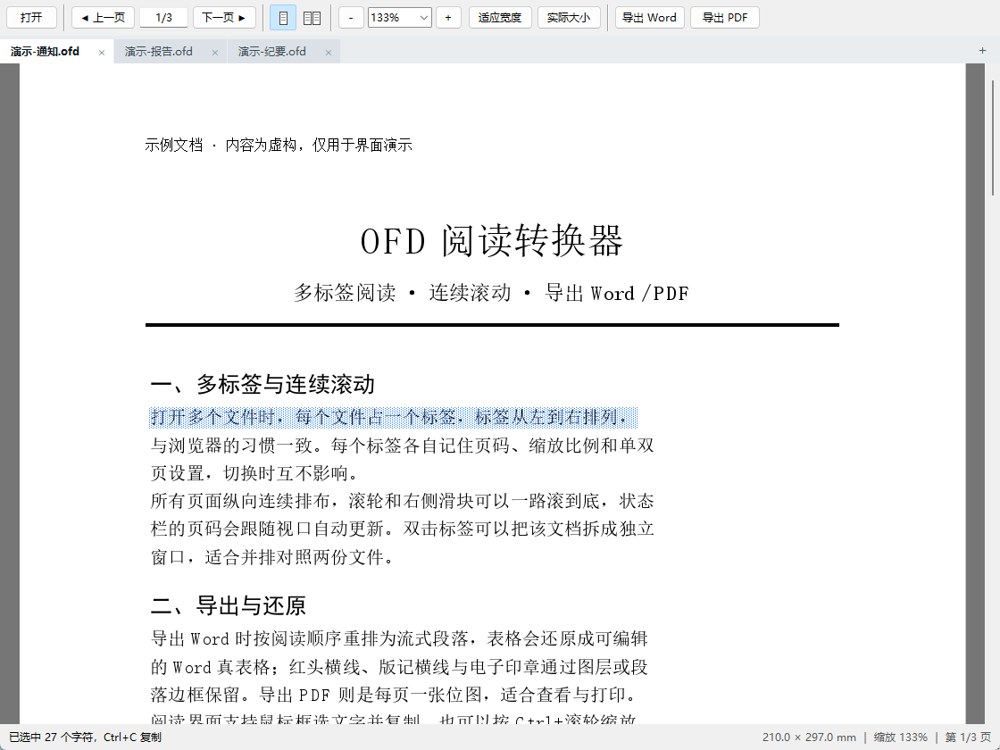
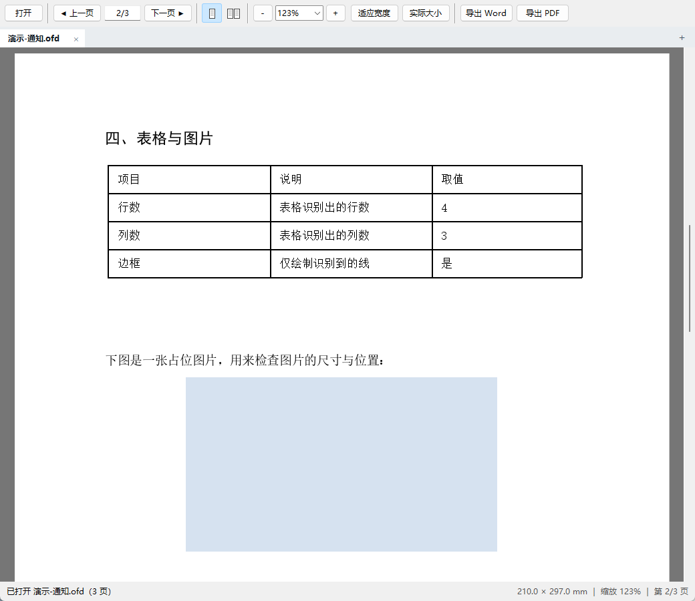

# OFD 阅读转换器

[](https://github.com/liumiaozhi/ofd-reader/actions/workflows/build.yml)
[](LICENSE)

Windows 桌面程序：打开阅读 `.ofd` 版式文档，并可导出为 Word（可编辑）或 PDF。
同时保留命令行脚本形态，便于批处理与二次集成。

> 现成程序见 [Releases](https://github.com/liumiaozhi/ofd-reader/releases/latest)：
> `ofd-reader-<版本>.exe`（单文件，约 18 MB，Windows 7 SP1 及以上）。也可以按第三节自行打包。
> 下载后可随意改名，程序窗口标题固定为「OFD 阅读转换器」。

- **多文档标签**：一次打开多个 `.ofd`，标签像浏览器一样从左到右排列，每个标签各自记页码/缩放/选中
- **独立窗口**：双击标签或右键「在新窗口中打开」，把文档拆成独立窗口；一个窗口里也能继续开多个标签
- **连续滚动阅读**：所有页面纵向排开，滚轮 / 右侧滑块像 Word 一样浏览，页码随滚动自动跟随
- **单页 / 双页**：工具栏两个小图标切换（默认单页），也可双击页面切换
- **框选复制**：鼠标拖选页面文字，蓝色高亮，Ctrl+C 复制
- **缩放**：每次 10% 一档，另有适应宽度、实际大小；窗口变宽变窄时页面自动居中
- **导出 Word**：流式排版，表格是可编辑的 Word 真表格
- **导出 PDF**：每页一张位图，适合查看与打印
- **右键集成**：可注册到资源管理器「打开方式」，右击 `.ofd` 直接打开

## 界面



*多标签：一次打开多个文件，标签从左到右排列；框选文字后 Ctrl+C 复制*



*双击标签拆成独立窗口，可并排对照；表格与图片按页面原样渲染*

> 截图由 `tools/capture_screenshots.py` 用**合成样本**生成，不含任何真实文档内容。

## 一、直接使用 exe（推荐）

从 [Releases](https://github.com/liumiaozhi/ofd-reader/releases/latest) 下载
`ofd-reader-<版本>.exe`（附件用英文名是为了避开 GitHub 对中文文件名的截断），
单文件绿色程序，约 18 MB，拷到任意位置双击即可，不用装 Python。

### 运行前提（Windows 7 特别注意）

| 项目 | 要求 |
|---|---|
| 系统 | Windows 7 SP1 及以上（64 位） |
| 运行库 | 已安装 UCRT（KB2999226）与 VC++ 2015-2019 运行库 |
| 内存 | 512 MB 以上，处理大文件建议 1 GB |

Win7 如果提示缺少 `api-ms-win-crt-*.dll`，装一下 KB2999226 即可；这个补丁在大多数已更新的
Win7 上已经有了。程序本身用 Python 3.8 打包——它是**最后一个支持 Windows 7 的官方 CPython 版本**。

### 界面操作

| 操作 | 方式 |
|---|---|
| 打开文件 | 工具栏「打开」/ Ctrl+O / 直接把文件拖到 exe 图标上 / 右键「打开方式」；对话框里按住 Ctrl 可多选，一次开成多个标签 |
| 切换标签 | 点标签，或 Ctrl+Tab / Ctrl+Shift+Tab（Ctrl+PageUp/PageDown 也行） |
| 关闭标签 | 标签上的 `×`、中键点击、Ctrl+W；右键标签可「关闭其他／全部」 |
| 独立窗口 | 双击标签，或右键「在新窗口中打开」；Ctrl+N 直接开一个新窗口 |
| 浏览 | 滚轮上下滚动（所有页面连续排布），或拖动右侧滑块 |
| 翻页 | ← → 方向键、PageUp/PageDown，或在页码框输入后回车（会自动滚到该页） |
| 单页 / 双页 | 工具栏两个页形小图标，或双击页面空白处 |
| 缩放 | Ctrl+滚轮、Ctrl+加号/减号，**每次 10%**；也可用工具栏下拉框 |
| 适应宽度 / 实际大小 | Ctrl+0 / Ctrl+1 |
| 选中复制 | 页面上按住左键拖动框选，Ctrl+C 复制；右击有「复制」菜单；Esc 取消 |
| 导出 | 文件菜单「导出为 Word…」（Ctrl+S）、「导出为 PDF…」（Ctrl+P） |

### 加进右键「打开方式」

菜单 **工具 → 添加到右键「打开方式」**，会弹两次确认：

1. 是否同时设为 `.ofd` 的**默认**打开程序（选「否」只加入候选列表，不改动现有默认）；
2. 写入的是当前用户注册表（`HKCU\Software\Classes`），**不需要管理员权限**。

注册后可以：右击 `.ofd` →「打开方式」→ 选择「OFD 阅读转换器」；若设为默认，双击 `.ofd` 直接打开。

移除去菜单 **工具 → 从右键菜单移除**。也可以命令行：

```bat
ofd阅读转换器.exe --register            :: 只加入「打开方式」候选
ofd阅读转换器.exe --register --default  :: 同时设为默认
ofd阅读转换器.exe --unregister          :: 移除
```

> 注意：注册的是**当前 exe 的完整路径**。如果把 exe 挪到别处，需要重新注册一次。

一次选中多个 `.ofd` 再右键「打开方式」，它们会作为多个标签在同一个窗口里打开；
程序也接受多个命令行参数：`ofd阅读转换器.exe a.ofd b.ofd c.ofd`。

## 二、命令行脚本

不想用界面、或要批量处理时，直接用底层脚本：

```bash
python -m pip install -r requirements.txt

python ofd2docx.py "通知.ofd"                      # 输出同名 .docx
python ofd2docx.py "通知.ofd" -o "结果.docx"
python ofd2docx.py "通知.ofd" --report r.json -v   # 附带转换报告
python ofd2docx.py --self-test                     # 内建自测（38 项断言）
```

退出码：`0` 成功 / `1` 参数或读写失败 / `2` 格式错误 / `3` 加密或不支持 / `4` 有告警（仅 `--strict`）。

## 三、自己打包

```bat
build.bat
```

或手动：

```bat
python -m PyInstaller ofd_reader.spec --noconfirm --clean
```

产物在 `dist\ofd阅读转换器.exe`。`ofd_reader.spec` 同时兼容 PyInstaller 4.x 与 6.x：

- **6.x**：当前环境默认版本（`PyInstaller 6.17`），已验证可打包运行。
- **4.10**：如果 6.x 打出的包在 Win7 上启动即报 `Failed to execute script`，
  执行 `pip install pyinstaller==4.10` 后重跑同一个 spec 即可，无需改配置。
  4.10 是 Win7 场景下验证最充分的版本。

打包后的自检（不需要人盯着看）：

```bat
dist\ofd阅读转换器.exe --selftest 样本.ofd --report check.txt
dist\ofd阅读转换器.exe --smoke-gui 样本.ofd --report gui.txt
```

前者验证解析、渲染、导出 Word/PDF 全链路；后者真实创建窗口，跑一遍「两个标签 → 滚动翻页 →
双页 → 缩放 → 框选 → 拆成独立窗口 → 关闭全部标签」的流程后自动退出。

冒烟测试默认用同一个文件开两个标签；想验证更多标签的排布，可以用环境变量追加文件：

```bat
set OFD_READER_SMOKE_EXTRA=D://样本//a.ofd;D://样本//b.ofd
dist\ofd阅读转换器.exe --smoke-gui 样本.ofd --report gui.txt
```

## 四、目录结构

| 文件 | 说明 |
|---|---|
| `ofd_reader.py` | 桌面程序：多标签/多窗口界面、连续滚动、双页、框选、导出、文件关联、自检 |
| `ofd_view.py` | 页面渲染（PIL）与 PDF 导出 |
| `ofd2docx.py` | OFD 解析与 Word 导出内核，也可单独当命令行用 |
| `ofd_reader.spec` | PyInstaller 打包配置 |
| `version_info.txt` | exe 的版本资源（文件属性里显示的信息） |
| `build.bat` | 一键打包 |
| `assets/logo.ico` `logo.png` | 程序图标（16/24/32/48/64/128/256 多尺寸） |
| `tools/make_icon.py` | 图标生成脚本（Pillow 绘制，不依赖 ImageMagick） |
| `tools/make_sample.py` | 合成演示用 OFD（自测、CI 与截图都用它，内容虚构） |
| `tools/capture_screenshots.py` | 生成 README 截图（需要桌面环境） |
| `tools/inspect_ofd.py` | 红头体检：列出某页顶部对象的字号/字体/CTM/颜色，定位显示异常 |
| `docs/screenshots/` | README 用的界面截图 |
| `LICENSE` | MIT 许可证 |
| `tests/` | 校验脚本：文本逐行比对、纵向位置精度、用 Word 打开验证 |
| `out/` | 转换与渲染产物（本地生成，不随仓库分发） |

## 五、关于样本与隐私

- 仓库里不含任何真实公文：`.ofd` / `.docx` / `.pdf` 与 `out/` 目录都在 `.gitignore` 中排除。
- 自测用的合成样本由 `ofd2docx.py --self-test` 现场生成，不需要外部文件。
- 文本回归请用自己的期望文本：`python tests/verify_docx_text.py 结果.docx 期望.txt`
  （期望文本请放在 `samples/` 下，同样已被忽略）。
- 界面/流程回归：`ofd阅读转换器.exe --smoke-gui <你的样本.ofd> --report out.txt`。

## 六、已知限制

**阅读视图**

1. 按页面渲染，文字、图片、矢量线条、**电子印章**都会画出来；阴影、渐变、裁剪路径、透明度叠加等装饰效果不还原。
2. 印章从签章数据（`SignValue.dat`）里的内嵌图片提取，白底会自动转透明，盖在文字上仍能读出字。
   若签章里没有图片（只有数字签名），则没有可视印章。
3. 缺字体时用系统相近字体替代（例如本机没装「方正小标宋简体」，大标题会用宋体显示）。
   **为什么不直接用 OFD 内嵌字体**：内嵌字体是按字形索引裁剪的子集，文件里没有 cmap 表，
   按 Unicode 取字只会得到空白，所以只能走系统中文字体。
4. 连续滚动是"虚拟化渲染"：只为视口附近的页面生成位图，其余显示"第 N 页"占位框，
   滚到那里才会画出来。长文档因此不会一次性吃掉大量内存。
5. 多标签时，切走的标签会释放已渲染的位图（页码、缩放、滚动位置仍保留），
   再多开几个文档也不会把内存吃满；切回来会立即重绘。
6. 标签宽度固定上限，名字过长会截断；同一个文件开两次时标题后面带 `·2`。
7. 选中的文字按字形位置还原，跨栏或跨页时按"从上到下、从左到右"拼装；
   与 Word 里的选择行为不完全一致（这是固定版式阅读器的通病）。

**导出 Word**

1. 流式排版，不是像素级复刻：换行位置、字间距可能与原件有细微差异（实测纵向偏差 ≤ 2.2 mm）。
2. 一个 OFD 文字行 = 一个 Word 段落；同一视觉行的多栏文本会合并成一行。
3. 表格只支持由水平/垂直线段构成的规则表格；斜线表头、跨页表、嵌套表不支持。
4. **红头横线、版记横线、印章**等非文字元素会以两种方式还原：
   - 远离文字的线条（如红头线）与印章：画成整页透明图层，浮动定位到页面上；
   - 紧贴文字下方的线条（版记区的那几条）：改成**段落底边框**，跟着段落走，
     这样 Word 重排时也不会出现"线压在字上"。
5. 水印、手写批注、超链接、书签、大纲不转换，只在报告里统计数量。
6. 字体不嵌入，只记录字体名；打开文档的机器缺字体时 Word 会自动替换。

**导出 PDF**

1. PDF 每页是一张 150 DPI 位图，适合查看与打印，但**文字不可选中、不可搜索**。
2. 需要可编辑/可检索的文档，请用「导出 Word」。

**其他**

1. 加密或带口令保护的 OFD 不支持，会直接报错（可先用 OFD 阅读器另存为未加密文件）。
2. 只用字形索引（Glyphs/CGTransform）描述、不含 Unicode 的文字对象无法还原。

## 七、排错

| 现象 | 处理 |
|---|---|
| 双击 exe 没反应 | 先用命令行跑 `ofd阅读转换器.exe --selftest 样本.ofd` 看报错 |
| 提示缺少 `api-ms-win-crt-*.dll` | 装 KB2999226（UCRT），或装 VC++ 2015-2019 运行库 |
| 右击「打开方式」里找不到本程序 | 重新用菜单注册一次；仍不行就重启资源管理器 |
| 中文显示成方框 | 系统缺字体。公文常用的「方正小标宋简体」需单独安装 |
| 导出 Word 提示文件被占用 | 先关掉已经打开的 Word 文档 |
| 表格没识别出来 | 该表格没有完整边框线，识别置信度不足会按正文输出（报告里有 `TABLE_REJECTED`） |
| 标签太多看不到后面的 | 标签栏支持横向滚动：在标签栏上滚轮，或拖动下方滑块 |
| 红头颜色发黑/发灰 | 该文件的颜色可能用调色板（ColorSpace Type="Index"）。1.2.2 之前的版本会把索引当 RGB，现已支持；若仍不对，用 `python tools/inspect_ofd.py 文件.ofd` 看颜色空间与对象属性 |
| 红头文字错位/重叠 | 同上，用 `tools/inspect_ofd.py` 把「顶部对象」发我：重点看字号（mm 与 pt）、CTM、模板页与 Clips |
| 想同时看两份文件 | 双击其中一个标签拆成独立窗口，两个窗口可并排摆放 |

## 八、持续集成

`.github/workflows/build.yml` 在 `windows-latest` + Python 3.8 上跑三步：

1. **语法门禁**：`py_compile` 编译三个模块，确保没有超出 3.8 的语法；
2. **核心自测**：`python ofd2docx.py --self-test`（38 项断言，现场合成样本，不依赖外部文件）；
3. **打包后验证**：用 spec 打出 exe，再跑 `--selftest`（解析/渲染/导出）与 `--smoke-gui`
   （多标签 → 滚动 → 双页 → 缩放 → 框选 → 拆窗 → 关闭全部），任何一步失败就判构建失败。

产物 `ofd-reader-win64` 作为 Actions artifact 保留；打 `v*` 标签时会自动改名成
`ofd-reader-<tag>.exe` 附加到同名 Release。

## 九、许可证

[MIT](LICENSE) © 2026 liumiaozhi
